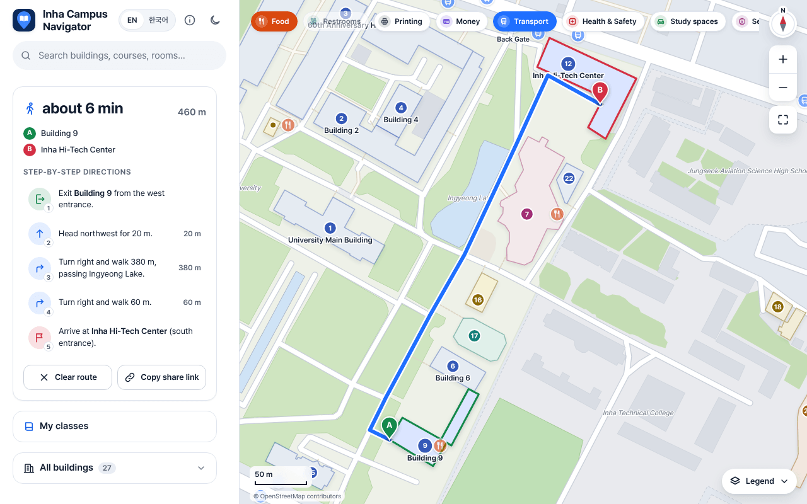
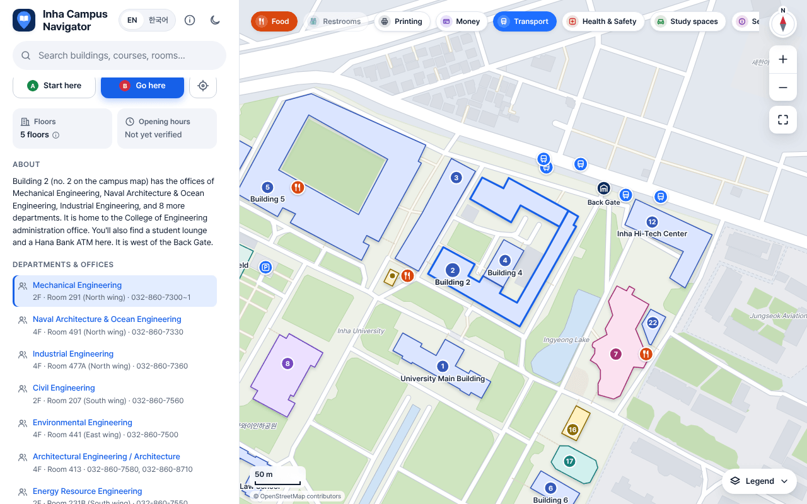
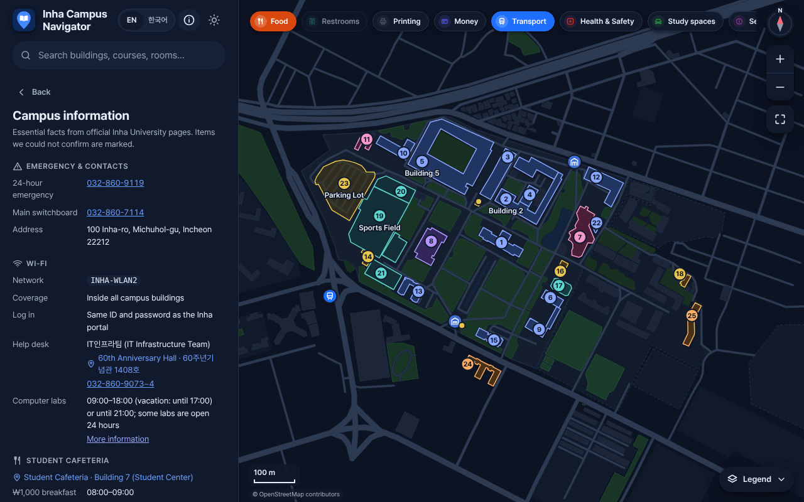
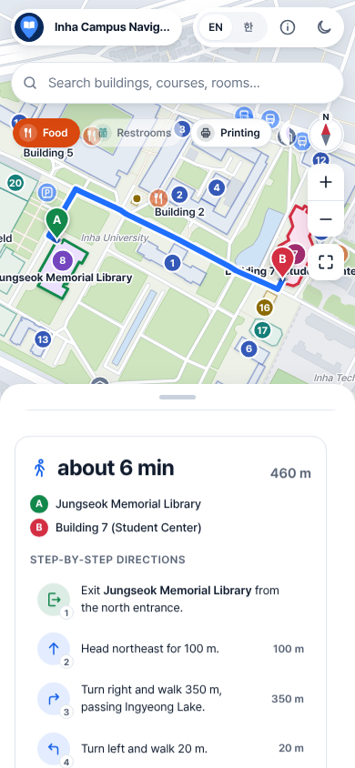
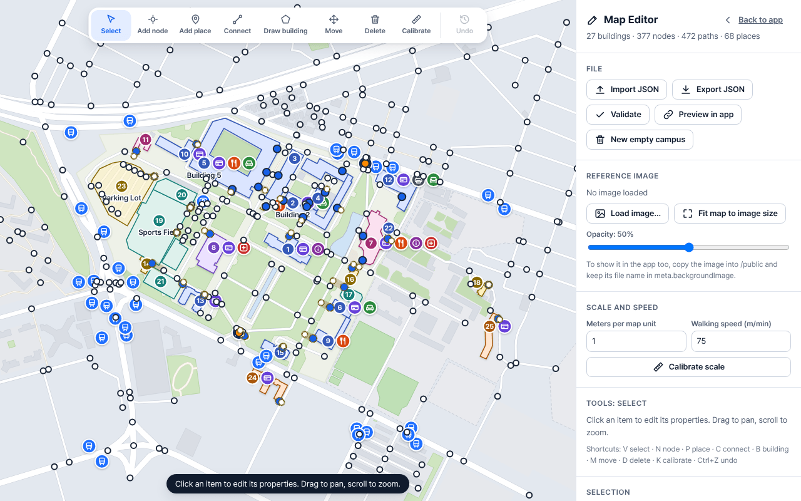

# Inha Campus Navigator

Walking map for Inha University Yonghyeon campus (인하대학교 용현캠퍼스).

Made for students who need to find buildings, offices, or rooms like `2남 212호` and get walking directions (English / 한국어).

**Live demo:** https://inha-campus-navigator.vercel.app

> This is a student project, not an official Inha service.

## Screenshots











## Features

- Real campus paths from OpenStreetMap
- Shortest walking route with step-by-step directions
- Step-free option
- Search by building, department, room code, café, etc.
- Use my location (stays on the device)
- My Classes (saved in browser only)
- Building info with sources
- Works offline (PWA)
- Simple map editor (`?edit=1`)

## How to run

```bash
npm install
npm run dev

Open http://localhost:5173

Other commands:

- `npm test` — run tests
- `npm run validate` — check data
- `npm run build` — production build
- `npm run data:build` — rebuild campus data
- `npm run reports` — update report files

## Data sources

- Paths and building shapes → OpenStreetMap
- Building names, offices, facilities → official inha.ac.kr pages
- Photos → Wikimedia Commons or our own photos

## Room codes

Examples that work:

- `2남 212호`
- `하이테크 1012`
- `60주년 901A호`

## Map Editor

Open with `?edit=1` to fix entrances, paths, or amenities.  
Export the edits and put the file in `data-raw/edits/`, then run `npm run data:build`.

## Known gaps

- Many indoor amenities still need checking on campus
- Most buildings still need photos (see `PHOTOS-TODO.md`)
- Some office and library info is incomplete

## Credits

- Map data © OpenStreetMap contributors
- Photos from Wikimedia Commons
- Everything else is student work